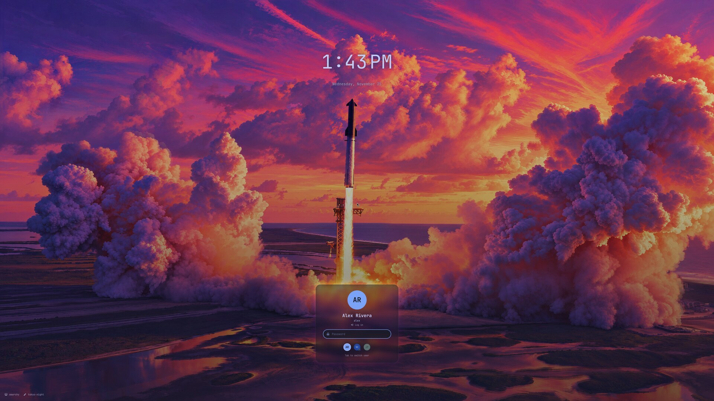
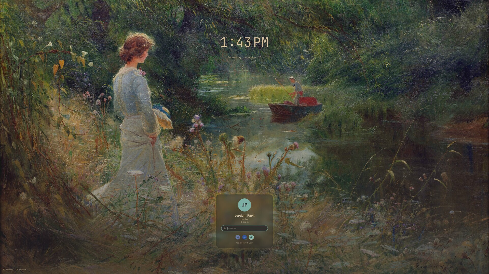

# omarchy-greeter

A multi-user login screen and lock screen for [Omarchy](https://omarchy.org). For computers that more than one person uses, or one person with separate accounts (work and personal, say).

- **Each account looks like its own desktop.** The login screen shows the selected account's Omarchy background (video too, if you allow it) and colors itself from that account's theme. Switching accounts wipes to the next background with the same reveal the desktop uses.
- **Sized like the desktop.** Each account's monitor scale and Omarchy font size carry over to the login screen.
- **Knows who is signed in.** Accounts with a session running read **Locked · resumes session**; the rest read **Log in**.
- **Multi-user lock screen.** The lock shows who it belongs to, who else is signed in, and **Switch user**, which opens the login screen while your session stays locked. Coming back takes one password.
- **One monitor.** Optionally show the login and lock forms on one monitor only and keep the rest black.
- **One password at boot (optional).** On an encrypted disk, the disk password can also log you in once, so you type one password instead of two (see [security](#one-password-at-boot)).
- **Settings in the Omarchy menu**, under **Setup > Login & Lock**, plus an `omarchy-greeter` command for the same and for managing accounts.

| Tokyo Night account | Catppuccin Latte account, signed in | Gruvbox account |
|---|---|---|
|  |  |  |

 Login & Lock in the Omarchy menu" width="276" align="right">

## Requirements

- Omarchy 4.5 or newer (Hyprland with the Lua config, the Quickshell desktop, SDDM, the uwsm session). These are all Omarchy defaults.
- An Arch-based Omarchy install (it is packaged with `makepkg`).

## Install

From the latest [release](https://github.com/BrandonDedolph/omarchy-greeter/releases/latest):

```bash
curl -fsSL https://github.com/BrandonDedolph/omarchy-greeter/releases/latest/download/install.sh | bash
```

It downloads the package, checks its signature against the project's release key, and installs it with `pacman` (it asks for your password). Nothing is installed if the signature does not match. The release key's fingerprint is `SHA256:FUHW/eAyg1oZyYLBpEp072NR5u15Z3heo2QpCmxi2fY`; to check it yourself, see [SECURITY.md](SECURITY.md#release-signing). You can read [the script](scripts/install.sh) first, or build from source instead: `git clone https://github.com/BrandonDedolph/omarchy-greeter.git && cd omarchy-greeter && makepkg -si`.

(An AUR package will follow once AUR account registration reopens.)

Then log out once (or reboot). At your next login the package:

- publishes your look for the login screen;
- switches you to the multi-user lock screen (a one-time desktop reload);
- adds **Setup > Login & Lock** to your Omarchy menu.

Every other account gets the same at its own first login. The login screen reads every account's look at boot, so an account shows its own theme even when it is not signed in (a brand-new account shows the default look until its first login).

To pick the monitor for the login and lock forms, open **Setup > Login & Lock > Monitor > This One** on the monitor you want, or run `omarchy-greeter monitor focused`.

## Updates

omarchy-greeter updates itself when you run `omarchy update`: at the end, Omarchy runs omarchy-greeter's update hook, which installs a newer release if there is one. Every release is signed, and the update is installed only if its signature matches the release key the installed version ships with. Releases and their notes are on the [releases page](https://github.com/BrandonDedolph/omarchy-greeter/releases).

```bash
omarchy-greeter update --check     # is there a newer release?
omarchy-greeter update             # install it now
omarchy-greeter auto-update off    # leave updates to you
```

An update takes effect at your next login. The one exception is when Omarchy itself changed its lock screen in the same update: then the multi-user lock is rebuilt right away, while `omarchy update` is restarting the desktop anyway.

## Adding another person

From the Omarchy menu: **Setup > Login & Lock > Accounts > Add**. Or in a terminal:

```bash
omarchy-greeter user add
```

It asks for the account name, the name to show on the login screen, whether the account should be an admin, and a password. The new account starts from Omarchy's defaults (`/etc/skel`), and Omarchy finishes setting it up at its first login. To sign in as it, lock your screen (<kbd>Super</kbd>+<kbd>Ctrl</kbd>+<kbd>L</kbd>), choose **Switch user**, and pick it.

## Admin rights

An admin can use `sudo`, install software and change system settings. Each admin is asked for **their own** password in system dialogs, not for the first admin's.

```bash
omarchy-greeter user list                 # every account and whether it is an admin
omarchy-greeter user admin alex on        # give alex admin rights
omarchy-greeter user admin alex off       # take them away
```

Or from the menu: **Setup > Login & Lock > Accounts > Admin**. Changes take effect at that account's next login. The last remaining admin cannot be removed, so the computer always has one.

## Settings

Every feature can be switched on or off. Machine-wide settings ask for an admin password; personal ones affect only your account.

| Setting | Menu (Setup > Login & Lock) | Command | Scope | Default |
|---|---|---|---|---|
| Monitor for the login and lock forms | Monitor | `omarchy-greeter monitor [focused\|all\|<name>]` | machine | all monitors |
| One password at boot, for your account | Boot Login | `omarchy-greeter boot-pass [on\|off] [account]` | machine | off |
| Video backgrounds on the login screen | Video Login | `omarchy-greeter video [on\|off]` | machine | off |
| Multi-user lock screen | User Lock | `omarchy-greeter lock [on\|off]` | you | on |
| Your look on the login screen | My Look | `omarchy-greeter publish [on\|off]` | you | on |
| Updates with `omarchy update` | | `omarchy-greeter auto-update [on\|off]` | you | on |
| The menu entries | (remove them) | `omarchy-greeter menu [install\|remove]` | you | on |

`omarchy-greeter status` shows them all. The machine-wide settings live in `/etc/omarchy-greeter.conf`.

With **My Look** off, the login screen shows the default look for your account. With **User Lock** off, you get Omarchy's own lock screen back.

## Remove

```bash
sudo pacman -R omarchy-greeter
```

This puts back Omarchy's login screen and, for every account, Omarchy's lock screen. It also removes the menu entries, the update hook and the PAM line, and deletes the published looks in `/var/lib/omarchy-greeter`. Log out and back in afterwards so a running desktop switches to Omarchy's lock. If the login screen ever fails to come up, switch to a text console (<kbd>Ctrl</kbd>+<kbd>Alt</kbd>+<kbd>F3</kbd>), log in, and run the same command.

## One password at boot

With Omarchy's full-disk encryption you type the disk password at boot and then an account password. With this on for your account, a disk password typed at boot also lets the **first** login skip the account password:

- only for the accounts an admin turned it on for (`omarchy-greeter boot-pass on` turns it on for yours). Anyone who knows the disk password can use it, so on a shared computer turn it on only for the account of whoever owns the disk password;
- only if `/` is on LUKS with no TPM or FIDO2 token and no key file (on the kernel command line, in `/etc/crypttab.initramfs`, in `/etc/cryptsetup-keys.d` or bundled into the initramfs), so a typed passphrase was the only way the disk could have opened;
- only if SDDM does not log anyone in automatically;
- only for an account that could also log in with its password (not locked, a real login shell);
- only for a fresh boot (not a soft-reboot), within 10 minutes of boot, and only for the **first** login of the boot: once anyone has signed in, by the login screen or on a console, it is gone;
- only to **start** an account that is not signed in. Returning to a signed-in (locked) session always takes that account's password.

Every use is logged to the journal (`journalctl -t omarchy-greeter`). This is the same trust Omarchy's own encrypted-disk autologin places in the disk password, narrowed to one login and letting you pick the account. If anything about the disk setup does not match, it stays off and you type your password as usual; `omarchy-greeter status` says why. Turn it off with `omarchy-greeter boot-pass off`.

It works by adding one line to the top of `/etc/pam.d/sddm` (`pam_exec` of `/usr/lib/omarchy-greeter/boot-unlock-auth`), which the package adds on install and removes on removal. The line does nothing unless the conditions above hold.

## How it works

- **The login screen** is an SDDM theme (`theme/`). SDDM runs it as the `sddm` user, who cannot read home folders. So each account publishes its look (a screen-sized still of its background, theme colors, font size, monitor layout, avatar from `~/.face`) to its own private folder, `/var/lib/omarchy-greeter/<account>/`. This happens from a systemd user unit whenever the theme, background, monitors or font change, and at boot for every account (`omarchy-greeter-sync`).
- **The login screen only reads checked copies.** The login screen receives every password, so it never opens an account's own files. A root service (`publish-view`) checks each published file (only regular files of a capped size, text matched against what is expected, display sizes parsed and rebuilt), re-encodes images as an unprivileged user, and copies the result into `/var/lib/omarchy-greeter/.view/`, readable only by the login screen. One account cannot freeze, crash or read files through the login screen another account uses. Video backgrounds are the exception, which is why they are off by default: when allowed, a video is repackaged as an unprivileged user, but the login screen still decodes the account's video stream.
- **The login screen's compositor** uses the same monitor modes as the desktop and stays in SDR, so moving between them causes no monitor blackout.
- **The lock screen** is Omarchy's own lock plugin, cloned into `~/.config/omarchy/plugins/<account>.lock` and patched (`lib/patch-lock.py`). The clone is rebuilt from Omarchy's current lock before the desktop starts whenever Omarchy's lock or the patch changes, so Omarchy's lock fixes keep arriving. If an Omarchy update ever changes the lock so much that the patch no longer fits, you get Omarchy's own lock and a notification. Nothing breaks.
- **A session out of sight is always locked.** If another account or the login screen comes to the front while a session is unlocked, that session locks itself (`omarchy-greeter-guard`, which works with either lock screen).
- **Switching back takes one password.** When you log back into your locked session from the login screen, SDDM asks logind to unlock it, and the lock screen follows once your session is in front again.

## Development

Test the login screen without logging out. The real looks in `/var/lib/omarchy-greeter/.view` are readable only by `sddm`, so point a copy of the theme at sample looks (a folder per account with `background.jpg`, `colors.toml`, `display.json`):

```bash
cp -r /usr/share/sddm/themes/omarchy-greeter /tmp/greeter-test
sed -i 's|^dataDir=.*|dataDir=/path/to/sample-looks|' /tmp/greeter-test/theme.conf
QML_XHR_ALLOW_FILE_READ=1 QML_XHR_ALLOW_FILE_WRITE=1 \
  sddm-greeter-qt6 --test-mode --theme /tmp/greeter-test
```

`make check` runs the static checks (bash syntax, shellcheck, QML and Lua syntax) and `make test` the tests, which run in temporary folders with stand-ins for root and Omarchy, so they never touch the real system. Both run on every push, and weekly against Omarchy's latest lock screen, so an Omarchy change that breaks the patch shows up before users hit it. Set `OMARCHY_LOCK_SOURCES=/path/to/omarchy/shell/plugins/lock` to also test the patch against another copy of the lock.

To release a version (maintainers): `scripts/release 1.1.0`. It checks the tree, builds the package from a clean export, signs it with the release key (an SSH key, `keys/allowed_signers`), tags `v1.1.0` and creates the GitHub release with the package, its signature and `install.sh`. Installed copies pick it up at their next `omarchy update`.

For screenshots without real account names, add `demoUsers=alex:Alex Rivera,sam:Sam Chen` (and optionally `demoHost=`) to a copy of `theme.conf`, with `dataDir=` pointing at sample looks.

## Security

To report a vulnerability, see [SECURITY.md](SECURITY.md). Please do not open a public issue for it.

## License

MIT
